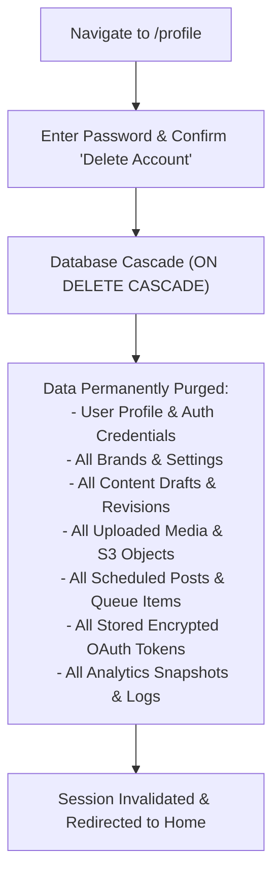

# SOCIALPILOT AI — USER DATA DELETION INSTRUCTIONS (DRAFT)

**Effective Date:** `[OWNER TO CONFIRM: e.g. November 24, 2026]`  
**Last Updated:** `[OWNER TO CONFIRM: e.g. November 24, 2026]`  
**Service URL:** `https://socialpilot-ai-y4lm.onrender.com`  
**Compliance Target:** Meta Platforms Developer Policy, TikTok Developer Policy, GDPR Article 17, CCPA  

---

## 1. OVERVIEW

At SocialPilot AI, we respect your privacy and empower you with complete, self-service control over your personal information, connected social media accounts, and uploaded content.

In accordance with the developer platform requirements of Meta (Facebook and Instagram), TikTok, Google, and LinkedIn, as well as applicable privacy regulations (such as GDPR and CCPA), this page provides clear, step-by-step instructions on how you can:
1. Disconnect individual social media accounts and revoke access tokens.
2. Delete specific media files or content drafts.
3. Permanently delete your entire SocialPilot AI user account and all associated data.
4. Request manual data deletion or confirmation.

---

## 2. DISCONNECTING A SOCIAL MEDIA ACCOUNT

If you wish to remove SocialPilot AI's access to a specific social media account (e.g. Facebook Page, Instagram Professional account, TikTok account, YouTube channel, or LinkedIn profile) without deleting your SocialPilot AI account, you can do so immediately from your dashboard:

### Step-by-Step Disconnection Process
1. Log in to your SocialPilot AI dashboard at `https://socialpilot-ai-y4lm.onrender.com/login`.
2. Select the brand associated with the social account.
3. Click on **Social Accounts** in the navigation menu (or navigate to `/brands/{brand_id}/social-accounts`).
4. Locate the connected account row and click the **Disconnect** button.
5. Confirm the action when prompted.

### What Happens When You Disconnect an Account:
- **Remote Revocation:** SocialPilot AI immediately sends a revocation request to the third-party platform's authorization server (e.g., Meta `/me/permissions`, TikTok `/oauth/revoke/`, Google `/revoke`, or LinkedIn `/revoke`) to invalidate the access token.
- **Database Deletion:** The encrypted OAuth access token and refresh token records (`social_account_tokens`) are **permanently and irreversibly deleted** from our production database.
- **Status Update:** The social account record status is transitioned to `'disconnected'`.
- **Cease Operations:** SocialPilot AI will immediately cease all scheduling, publishing, and analytics metric collection for that social account.

*(Note: Disconnecting an account does not delete posts that were previously published to your social media feeds. Those posts remain on the social network under your direct control.)*

---

## 3. REMOVING SOCIALPILOT AI FROM YOUR META (FACEBOOK / INSTAGRAM) SETTINGS

If you prefer to revoke access directly through Facebook or Instagram:
1. Log in to your Facebook account.
2. Go to **Settings & Privacy > Settings > Business Integrations** (or visit [https://www.facebook.com/settings?tab=business_tools](https://www.facebook.com/settings?tab=business_tools)).
3. Locate **SocialPilot AI** in the list of active integrations.
4. Select the checkbox next to SocialPilot AI and click **Remove**.
5. Confirm your choice.

Once removed in Meta settings, Meta invalidates our authorization token immediately. Any subsequent scheduled posts or API synchronization attempts by SocialPilot AI will be rejected by Meta's API.

---

## 4. PERMANENT ACCOUNT & DATA DELETION (SELF-SERVICE)

If you wish to permanently delete your SocialPilot AI user account and all personal information, brand settings, drafts, and assets, you can do so at any time using our automated self-service deletion workflow:

### Step-by-Step Account Deletion Process
1. Log in to SocialPilot AI at `https://socialpilot-ai-y4lm.onrender.com/login`.
2. Click your user profile in the top-right navigation or visit `https://socialpilot-ai-y4lm.onrender.com/profile`.
3. Scroll down to the **Delete Account** section.
4. Enter your current account password to verify your identity.
5. Click **Delete Account** to initiate permanent deletion.

### Technical Deletion Guarantees
SocialPilot AI's database schema enforces relational foreign key cascading (`ON DELETE CASCADE`). Executing account deletion permanently and immediately removes:
- **Identity & Authentication:** Your user record, password hash, email address, API access tokens, and active session cookies.
- **Brand Context:** All brand records, voice guidelines, keywords, tone preferences, and visual settings.
- **Drafts & Content:** All content drafts, variations, revisions, and generation jobs.
- **Media Files:** All database media metadata and all corresponding binary objects in Supabase Cloud Storage S3 (`brands/{brand_id}/media/...`).
- **Scheduling & Queues:** All scheduled posts, calendar entries, and publishing queue items.
- **Social Account Tokens:** All connected social account records and encrypted OAuth tokens.
- **Analytics:** All cached metrics, snapshots, and audience insights.

---

## 5. DATA THAT MAY REMAIN IN BACKUPS

When you delete your account or social account, the records are purged immediately from our active production database (`socialpilot` on TiDB Cloud Serverless) and cloud storage (Supabase S3).

- **Database Snapshots:** Like all enterprise cloud databases, automated transactional point-in-time recovery snapshots are maintained by our database provider (TiDB Cloud / AWS) for system disaster recovery purposes. These automated snapshots expire and age out automatically over a rolling retention window of **7 to 30 days**. It is technically infeasible to selectively alter pre-existing binary database snapshots; however, should a snapshot ever be restored, your deletion request will be re-applied.
- **Published Posts:** Posts, images, and videos previously published to third-party social media feeds (Facebook, Instagram, TikTok, YouTube, LinkedIn) remain on those platforms under your direct control and subject to their respective terms. SocialPilot AI cannot delete content from third-party networks after your account has been deleted. You can delete those posts directly using the native mobile apps or websites of the respective social platforms.

---

## 6. MANUAL DATA DELETION REQUESTS & SUPPORT

If you are unable to access your SocialPilot AI account, or if you require manual confirmation or assistance with data deletion, you may submit a formal deletion request via email:

**Email:** `[OWNER TO CONFIRM: e.g. privacy@socialpilot-ai.com or support@socialpilot-ai.com]`  
**Subject:** `Data Deletion Request — [Your Registered Email Address]`

Please include:
1. Your full name.
2. The email address registered with SocialPilot AI.
3. A clear statement requesting account deletion and data removal.

We will verify your request, process the deletion within **30 business days**, and send you written confirmation of the purge.

---

## 7. META DATA DELETION STATUS CALLBACK NOTICE

For users who remove SocialPilot AI via Facebook Business Integrations and require automated tracking, this page serves as our official **Data Deletion Instructions URL**.

To check the status of a previously requested deletion, or if you have questions regarding your data deletion rights, please contact our Data Protection Administrator at `[OWNER TO CONFIRM: e.g. support@socialpilot-ai.com]`.
