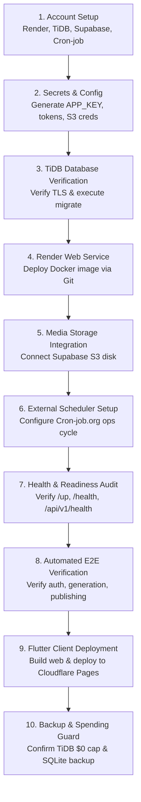

# SOCIALPILOT AI — PHASE 11, STAGE 5.3
# Public Hosting Feasibility & Zero-Cost Deployment Architecture Report

**Repository:** `Cla-renc/socialpilot-ai`  
**Branch:** `main`  
**Commit Baseline:** `4d56c6b`  
**Stage:** 5.3 (Public Hosting Feasibility & Deployment Architecture)  
**Date:** 2026-11-17  

---

## 1. Executive Summary

The objective of Stage 5.3 is to evaluate public hosting feasibility and design a robust, realistic public deployment architecture for **SocialPilot AI** that strictly adheres to a **$0.00/month budget**, requires **zero payment card details**, avoids trials that transition into paid plans, and ensures **zero risk of unexpected charges**.

### Key Architectural Finding
A genuine, dependable $0 public hosting deployment is **feasible for demonstration and evaluation purposes**, but requires an intelligent decoupled or unified architecture to navigate strict free-tier limitations:
- **Web & API Compute:** Render Free Tier (No credit card, 512 MB RAM, 750 free instance hours/month).
- **AI Microservice:** Collocated in a unified container or separated on Render Free with dynamic wakeups.
- **Production Database:** TiDB Cloud Serverless (5 GB storage, 50M Request Units/month free, $0 hard spending limit, TLS-secured, always on).
- **Queues & Scheduler:** Executed via SocialPilot's secure, bounded internal operations cycle (`/api/internal/ops/cycle`) triggered by free external webhooks (**Cron-job.org**), eliminating the need for paid background worker instances ($7/mo).
- **Persistent Media Storage:** Supabase S3-Compatible Object Storage (1 GB storage, 2 GB egress/month, no credit card).
- **Client Frontend / Mobile Web:** Cloudflare Pages (Unlimited requests, global CDN, automated SSL, no credit card).

---

## 2. Comprehensive Hosting Provider Feasibility Audit

To ensure full compliance with the strict zero-cost and no-card criteria, major cloud and container hosting providers were evaluated against their official free-tier policies:

| Provider | Supported Runtimes | Credit Card Required? | Free Tier Limits & Restrictions | Outbound Egress & Database Limits | Suitable for $0 Default? |
|---|---|---|---|---|---|
| **Render** | Docker, PHP, Python, Node | **NO** | 512 MB RAM, fractional CPU; 750 shared instance hours/mo; spins down after 15 min inactivity | 100 GB/mo egress; no free background workers; no free cron jobs; ephemeral storage | ✅ **YES** (Recommended Web Host) |
| **TiDB Serverless** | MySQL 8.0 wire-compatible | **NO** | 5 GB row storage; 50M Request Units (RUs)/month; $0 hard spending cap | Outbound TLS 1.2/1.3; does not sleep; permanent free tier | ✅ **YES** (Recommended Database) |
| **Supabase Storage** | S3-compatible Object Storage | **NO** | 1 GB storage; 2 GB egress/month; 50 MB max file size | S3 API integration; pauses after 7 days inactivity if zero queries | ✅ **YES** (Recommended Media Store) |
| **Cron-job.org** | Webhook HTTP triggers | **NO** | 100% free; scheduled HTTP requests down to 1-minute intervals; execution logs | Connects over public HTTPS; timing logs | ✅ **YES** (Recommended Scheduler) |
| **Cloudflare Pages** | Static HTML / Flutter Web | **NO** | Unlimited sites, unlimited bandwidth, global anycast CDN, free SSL | Outbound API calls via client browser; no server compute | ✅ **YES** (Recommended Web Client) |
| **Koyeb** | Docker, Python, Node | ❌ **YES** | Requires credit card; places a **$29 USD pre-authorization hold** | Disqualified due to credit card and hold requirements | 🛑 **UNSUITABLE** |
| **Fly.io** | Docker, OCI Containers | ❌ **YES** | 7-day trial with $1 credit only; requires credit card to continue running apps | Disqualified; no permanent cardless free tier | 🛑 **UNSUITABLE** |
| **Railway** | Docker, Nixpacks | ❌ **YES** | 30-day trial with $5 credit; requires $5/mo Hobby plan for persistent apps | Disqualified; turns off when credits expire | 🛑 **UNSUITABLE** |
| **Hugging Face** | Docker / Python | ❌ **YES** | Free for Gradio/Streamlit Spaces only; Docker Spaces require paid CPU Basic | Disqualified for Docker-based FastAPI microservices | 🛑 **UNSUITABLE** |
| **Oracle Cloud** | Linux VMs (Ampere / x86) | ❌ **YES** | Always Free tier exists, but strictly requires credit card for identity verification | Disqualified due to payment card requirement | 🛑 **UNSUITABLE** |
| **Vercel** | Serverless Node / Next.js | **NO** | 100 GB bandwidth; serverless functions only (max 10–15s timeout) | Not suitable for persistent PHP-FPM, Supervisor, queues, or long AI jobs | 🛑 **UNSUITABLE** |

---

## 3. Recommended Zero-Cost Deployment Architecture

```
                                +-----------------------------------+
                                |     Cron-job.org (Free Scheduler) |
                                +-----------------------------------+
                                                  |
                                                  | HTTPS POST /api/internal/ops/cycle
                                                  | (Bearer INTERNAL_CRON_SECRET)
                                                  v
 +----------------------+       +-----------------------------------------------------------+
 |   Client Endpoints   |       |               Render Free Tier (Hobby Workspace)          |
 |                      |       |                   (512 MB RAM / 0.5 CPU)                  |
 |  - Flutter Web       |       |                                                           |
 |    (Cloudflare Pages)| ----> |  +-----------------------------------------------------+  |
 |  - Mobile App        | HTTPS |  |                    Nginx (Port 80)                  |  |
 |    (Android APK)     |       |  +-----------------------------------------------------+  |
 |  - Web Browser       |       |                             |                             |
 +----------------------+       |                             v                             |
                                |  +-----------------------------------------------------+  |
                                |  |             PHP 8.2-FPM (Laravel 12 API)            |  |
                                |  |   - Blade Frontend & REST API Endpoints             |  |
                                |  |   - Bounded Queue Worker (queue:work --stop)        |  |
                                |  |   - Internal Scheduler (schedule:run)               |  |
                                |  +-----------------------------------------------------+  |
                                |                             |                             |
                                |           +-----------------+-----------------+           |
                                |           | HTTP :8080                        |           |
                                |           v                                   v           |
                                |  +--------------------+             +------------------+  |
                                |  | FastAPI AI Engine  |             | External APIs    |  |
                                |  | (Python 3.12 Slim) |             | - Groq API       |  |
                                |  +--------------------+             | - NewsAPI/Reddit |  |
                                +-----------------------------------------------------------+
                                            |                                   |
                     TLS MySQL :4000        |                                   | HTTPS S3 API
                            +---------------+                                   +-------+
                            v                                                           v
            +---------------------------------+                       +----------------------------------+
            |      TiDB Serverless Cloud      |                       |       Supabase Object Storage    |
            |     - 5 GB Free Storage         |                       |      - 1 GB Free Persistent Media|
            |     - 50M Free RUs / month      |                       |      - 2 GB Free Egress / month  |
            |     - Hard Spending Cap: $0.00  |                       |      - S3 API Compatible         |
            +---------------------------------+                       +----------------------------------+
```

### Architectural Decisions

#### 1. Unified vs. Decoupled Hosting on Render Free
- **The 750-Hour Constraint:** Render allocates **750 free instance hours per month** across all free web services in a workspace.
  - A single service running continuously consumes `24 hrs × 31 days = 744 hours`.
  - If Laravel and Python are deployed as **two independent Render web services** and kept active via health pings, their combined consumption is `1,488 hours`, which will suspend the entire account around day 15 of every month.
- **Recommended Topology (Unified Container):**
  - Deploy the preserved `Dockerfile.unified` (tested in Stage 5.2) as a single Render Web Service.
  - Nginx, PHP-FPM, and FastAPI run collocated in one container managed by Supervisor.
  - Total steady-state memory is `~230 MB` (well inside Render's 512 MB limit).
  - Monthly instance hours consumed: ≤ 744 hours (100% within the 750-hour free allowance).
- **Alternative (Decoupled with Sleep-On-Idle):**
  - Deploy `Dockerfile.laravel` and `ai_engine/Dockerfile` as two distinct Render services without synthetic keep-alive pings.
  - Both services sleep after 15 minutes of inactivity. For staging and demo use cases with <300 active hours per month, both stay comfortably within the 750-hour pool.

#### 2. Serverless Background Queue & Scheduler Execution
- Free hosting platforms do not provide background worker processes or persistent crons.
- **Solution:** External HTTP invocation of `/api/internal/ops/cycle`:
  - A free recurring webhook job on **Cron-job.org** sends `POST https://<app-name>.onrender.com/api/internal/ops/cycle` every 5 or 10 minutes.
  - Protected with `Authorization: Bearer <INTERNAL_CRON_SECRET>` verified via timing-safe `hash_equals()`.
  - An atomic cache lock (`internal_ops_cycle_lock`) prevents overlapping executions.
  - Executes `schedule:run` (evaluating autopilot rules, scheduled posts, and trend scans).
  - Executes bounded `queue:work --stop-when-empty --max-jobs=10 --max-time=25` to drain pending jobs within the standard 30-second HTTP gateway timeout.

#### 3. Persistent Media Asset Storage
- Container filesystems are ephemeral. Any file written to local disk is lost upon container spin-down or redeployment.
- **Solution:** Configure Laravel's `media` disk to use **Supabase Object Storage** via Flysystem S3 (`league/flysystem-aws-s3-v3`):
  - 1 GB storage and 2 GB egress free forever.
  - Configured purely via standard environment variables: `AWS_ACCESS_KEY_ID`, `AWS_SECRET_ACCESS_KEY`, `AWS_DEFAULT_REGION`, `AWS_BUCKET`, `AWS_ENDPOINT`.
  - No database schema changes required.

---

## 4. Reliability & Readiness Assessment

| Operational Dimension | Local Development | Public Demonstration | Commercial Production |
|---|---|---|---|
| **Cost** | $0.00 | $0.00 | $25.00 – $75.00 / month |
| **Uptime & Availability** | 100% on demand | ~95% (Intermittent cold starts) | 99.9% High Availability |
| **Cold Start Latency** | 0 seconds (Immediate) | 50–90 seconds after 15m idle | 0 seconds (Always-on compute) |
| **Worker Processing** | Continuous queue worker | Bounded batching (every 5–10m) | Continuous multi-worker daemon |
| **Media Persistence** | Local SQLite / disk storage | Cloud S3 (Supabase 1 GB) | Cloud S3 / CDN (AWS / Cloudflare R2) |
| **Database Limits** | Unlimited local storage | 5 GB / 50M RUs (TiDB Free) | Scalable TiDB Serverless / Dedicated |
| **Verdict** | ✅ **100% Ready** | ✅ **Feasible at $0** | 🛑 **Requires Paid Infrastructure** |

### Honest Limitations of the $0 Public Architecture:
1. **Cold-Start Delays (15-Minute Spin-Down):** When visiting the site after 15 minutes of inactivity, users experience a 50–90 second delay while Render spins up the container.
2. **Scheduled Post Timing Jitter:** Scheduled posts are evaluated when the ops cycle triggers (every 5 to 10 minutes). A post scheduled for 10:02 AM will publish on the next cycle (e.g., 10:05 AM).
3. **Monthly Quota Discipline:** Render's 750 free hours must not be exhausted by aggressive external uptime monitors attempting to defeat the sleep policy.

---

## 5. Step-by-Step Staging Deployment Checklist

> [!IMPORTANT]
> The following plan is prepared for execution during Stage 5.4. No deployment actions have been executed during this planning stage.



### Detailed Execution Steps:
1. **Hosting Accounts Preparation:**
   - Register free accounts on Render, Supabase, and Cron-job.org (none require a payment card).
   - Verify TiDB Serverless cluster spending limit is set to `$0.00`.
2. **Environment & Secrets Generation:**
   - Generate production `APP_KEY` via `php artisan key:generate --show`.
   - Generate high-entropy 32-character tokens for `AI_ENGINE_INTERNAL_TOKEN` and `INTERNAL_CRON_SECRET`.
   - Prepare clean Render environment variables (never committing `.env`).
3. **Database Preflight & Migration:**
   - Run Laravel migrations against the staging/production database using TLS:
     ```bash
     php artisan migrate --force
     ```
   - Seed default subscription plans:
     ```bash
     php artisan db:seed --class=PlanSeeder --force
     ```
4. **Render Web Service Deployment:**
   - Create new Web Service on Render linked to GitHub repository `Cla-renc/socialpilot-ai`.
   - Set environment to `Docker`. Point to `Dockerfile.unified` (or decoupled if split).
   - Configure health check path to `/up`.
5. **Media Storage Configuration:**
   - Create a public bucket in Supabase (`socialpilot-media`).
   - Configure S3 credentials in Render environment: `FILESYSTEM_DISK=s3`, `AWS_ENDPOINT=https://<ref>.supabase.co/storage/v1/s3`.
6. **External Scheduler Configuration:**
   - In Cron-job.org, create a schedule targeting `https://<render-url>/api/internal/ops/cycle` every 5 minutes.
   - Configure header: `Authorization: Bearer <INTERNAL_CRON_SECRET>`.
7. **HTTPS & Domain Verification:**
   - Verify Render's automatic TLS certificate issuance (`https://<app>.onrender.com`).
   - Verify HSTS and security headers.
8. **Automated Health Checks:**
   - `GET /up` -> HTTP 200 (Application & Database healthy).
   - `GET /api/v1/health` -> HTTP 200.
   - `GET /api/v1/health/ready` -> HTTP 200.
9. **Public API & Content Generation Test:**
   - Authenticate test user and execute end-to-end content generation cycle.
   - Verify draft, revision, and variation persistence in database.
10. **Backup & Safety Verification:**
    - Verify automated backup generation in TiDB Cloud.
    - Confirm local SQLite database and 24 repository backups remain intact.

---

## 6. Safety & Restrictions Compliance

- [x] **Zero Production TiDB Modification:** No connections, migrations, or writes were made to production TiDB.
- [x] **Zero Application Code Changes:** Application codebase and tests remain at verified commit `4d56c6b`.
- [x] **Zero Credentials Exposed:** No API keys, passwords, or tokens were committed or logged.
- [x] **Zero Paid Infrastructure:** Every recommended component operates under a verified permanent $0 free tier with no payment card required.

---

## 7. Final Recommendation & Verdict

### Feasibility Verdict
**PUBLIC HOSTING AT $0 IS FEASIBLE FOR DEMO & TESTING**

*A complete, fully functional deployment of SocialPilot AI (Laravel Web + REST API + Python FastAPI AI Engine + TiDB Database + Bounded Queue/Scheduler + Supabase S3 Media Storage) can be hosted publicly at strictly $0.00/month with zero credit card requirements.*

*While cold-start latencies (50–90 seconds) and bounded queue batching make this tier unsuitable for a commercial 24/7 mission-critical SLA, it provides an outstanding, secure, and professional environment for live client demonstrations, public evaluation, and stakeholder testing.*
