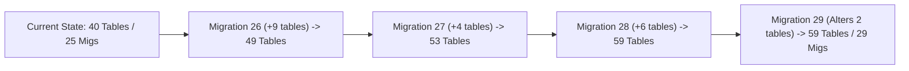

# SOCIALPILOT AI — PHASE 11, STAGE 5.4.2.5.5
## Remaining Staging Migrations 26–29 Readiness Report (READ-ONLY)

**Repository:** `Cla-renc/socialpilot-ai`  
**Branch:** `main`  
**Stage:** 5.4.2.5.5 (Remaining Staging Migrations 26–29 Readiness Review)  
**Date:** 2026-11-18  
**Preceding Commits:** `cdbaf01` (Pre-Execution Gate), `c4d9d4f` (Backup Report), `38b4b39` (Cleanup Authorization), `0a5cb2f` (Cleanup Report), `633dc70` (Migration 25 Report)  
**Report Generated:** 2026-11-18T19:18:00+03:00  

---

## FINAL DECISION

```
A — FOUR MIGRATIONS REVIEWED; READY FOR EXPLICIT EXECUTION AUTHORIZATION.
```

> [!IMPORTANT]
> **THIS STAGE IS STRICTLY READ-ONLY PLANNING & VERIFICATION.**  
> Zero migrations were executed in this stage. No schema modifications, DDL, or DML were performed.  
> Execution of Migrations 26–29 strictly awaits separate explicit human authorization.

---

## 1. STEP 1 — LIVE DATABASE IDENTIFICATION & ISOLATION

Live connection parameters and database state were audited against `socialpilot_staging`:

| Verification Property | Expected Target | Live Audited State | Status |
|:---|:---|:---|:---|
| **Active Database** | `socialpilot_staging` | `socialpilot_staging` | ✅ MATCH |
| **Connection Name** | `tidb_staging_migrator` | `tidb_staging_migrator` | ✅ MATCH |
| **Authenticated User** | `AZDARrqgy4MBFGE.staging_migrator` | `AZDARrqgy4MBFGE.staging_migrator@102.0.27.66` | ✅ MATCH |
| **TLS Transport Cipher** | Required / Active | `TLS_AES_128_GCM_SHA256` | ✅ ENCRYPTED |
| **Current Base Tables** | Exactly 40 base tables | **40 tables** | ✅ MATCH |
| **Completed Migration Records** | Exactly 25 records | **25 records** (Batches 1 & 2) | ✅ MATCH |
| **Pending Migrations** | Exactly 4 pending (26–29) | **4 pending** (confirmed) | ✅ MATCH |
| **Production Isolation (`socialpilot`)** | Access Denied | `SQLSTATE[42000]: 1142 SELECT command denied` | ✅ STRICTLY ISOLATED |
| **Test DB Isolation (`socialpilot_migration_test`)** | Access Denied | `SQLSTATE[42000]: 1142 SELECT command denied` | ✅ STRICTLY ISOLATED |

---

## 2. STEP 2 — PENDING MIGRATION INVENTORY & READINESS REVIEW

All four pending migration source files were analyzed in detail:

### 2.1 Migration 26: `2026_11_13_230000_create_scheduling_and_autopilot_tables.php`
- **Purpose:** Core post scheduling, queue management, autopilot rules, and time recommendation engine.
- **Tables Created (9 tables):**
  1. `scheduled_posts` (24 columns, 4 FKs: `users`, `brands`, `brand_content_drafts`, `users`)
  2. `scheduled_post_platforms` (14 columns, 2 FKs: `scheduled_posts`, `social_accounts`)
  3. `scheduled_post_media` (7 columns, 2 FKs: `scheduled_posts`, `media_assets`) — *Note: references `media_assets` successfully created in Migration 25.*
  4. `publishing_queues` (12 columns, 2 FKs: `users`, `brands`)
  5. `publishing_queue_items` (12 columns, 5 FKs: `publishing_queues`, `users`, `brands`, `scheduled_posts`, `brand_content_drafts`)
  6. `autopilot_settings` (15 columns, 2 FKs: `brands` [unique], `users`)
  7. `autopilot_rules` (11 columns, 2 FKs: `brands`, `users`)
  8. `autopilot_activity_logs` (8 columns, 2 FKs: `brands`, `users`)
  9. `scheduling_recommendations` (14 columns, 2 FKs: `brands`, `users`)
- **Dependencies:** `users`, `brands`, `brand_content_drafts`, `social_accounts`, `media_assets`. All dependency tables are present and healthy in `socialpilot_staging`.
- **Potential Destructive Operations:** None. Pure table creations.
- **Potential Duplicate Objects:** None. Zero name collisions with existing 40 tables.

### 2.2 Migration 27: `2026_11_14_100000_create_publishing_agent_tables.php`
- **Purpose:** Autonomous publishing execution, OAuth state / PKCE tracking, delivery notifications, and webhook ingress.
- **Tables Created (4 tables):**
  1. `publishing_attempts` (20 columns, 5 FKs: `scheduled_posts`, `scheduled_post_platforms`, `social_accounts`, `brands`, `users`)
  2. `oauth_states` (12 columns, 3 FKs: `users`, `brands`, `social_accounts`, unique on `state_hash`)
  3. `publishing_notifications` (12 columns, 4 FKs: `users`, `brands`, `publishing_attempts`, `scheduled_posts`)
  4. `publishing_webhook_events` (10 columns, 0 FKs)
- **Dependencies:** `users`, `brands`, `social_accounts`, and tables created in Migration 26 (`scheduled_posts`, `scheduled_post_platforms`). Sequential ordering ensures all targets exist.
- **Potential Destructive Operations:** None. Pure table creations.
- **Potential Duplicate Objects:** None. Zero name collisions.

### 2.3 Migration 28: `2026_11_14_150000_create_analytics_and_ai_optimization_tables.php`
- **Purpose:** Multi-platform analytics snapshots, post performance metrics, audience demographics, collection health logs, reporting, and AI optimization recommendations.
- **Tables Created (6 tables):**
  1. `analytics_snapshots` (16 columns, 2 FKs: `brands`, `social_accounts`, unique composite index)
  2. `post_analytics` (16 columns, 4 FKs: `brands`, `social_accounts`, `publishing_attempts`, `scheduled_posts`, unique composite index)
  3. `audience_insights` (13 columns, 2 FKs: `brands`, `social_accounts`, unique composite index)
  4. `analytics_collection_logs` (13 columns, 2 FKs: `brands`, `social_accounts`)
  5. `analytics_reports` (15 columns, 2 FKs: `users`, `brands`)
  6. `ai_optimization_recommendations` (15 columns, 2 FKs: `users`, `brands`)
- **Dependencies:** `brands`, `social_accounts`, `users`, `publishing_attempts` (from Migration 27), `scheduled_posts` (from Migration 26). Sequential ordering ensures all targets exist.
- **Potential Destructive Operations:** None. Pure table creations.
- **Potential Duplicate Objects:** None. Zero name collisions.

### 2.4 Migration 29: `2026_11_16_200000_add_integrity_constraints_to_content_generation_tables.php`
- **Purpose:** Adds strict referential uniqueness constraints on content generation tables to prevent duplicate jobs and revision collisions.
- **Tables Altered (2 tables, 0 new tables):**
  1. `brand_content_drafts`: Adds unique constraint `bcd_generation_job_id_unique` on `generation_job_id`.
  2. `content_revisions`: Adds unique composite constraint `cr_draft_id_revision_number_unique` on `(draft_id, revision_number)`.
- **Pre-flight Checks in Migration Code:** Queries `brand_content_drafts` and `content_revisions` to verify zero duplicate records exist before applying unique indices. In `socialpilot_staging`, both tables contain 0 rows; checks pass instantaneously.
- **Dependencies:** `brand_content_drafts` (Migration 11), `content_revisions` (Migration 24). Both tables exist and are healthy.
- **Potential Destructive Operations:** None. Non-destructive index additions.

---

## 3. STEP 3 — PROPOSED EXECUTION PLAN (PENDING AUTHORIZATION)

### 3.1 Recommended Execution Strategy
To avoid long-running monolithic connection timeouts over cloud TLS (such as the connection reset encountered in Stage 5.4.2.4.2), migrations should be executed **sequentially using path-specific Artisan commands with `--step`**:



### 3.2 Exact Ordered Commands

#### Execution 1: Migration 26
```bash
php artisan migrate --database=tidb_staging_migrator \
  --path=database/migrations/2026_11_13_230000_create_scheduling_and_autopilot_tables.php \
  --step --force
```
- **Expected Change:** +9 tables (`scheduled_posts`, `scheduled_post_platforms`, `scheduled_post_media`, `publishing_queues`, `publishing_queue_items`, `autopilot_settings`, `autopilot_rules`, `autopilot_activity_logs`, `scheduling_recommendations`).
- **Intermediate Table Count:** **49 tables**.
- **Intermediate Migration Count:** **26 records**.

#### Execution 2: Migration 27
```bash
php artisan migrate --database=tidb_staging_migrator \
  --path=database/migrations/2026_11_14_100000_create_publishing_agent_tables.php \
  --step --force
```
- **Expected Change:** +4 tables (`publishing_attempts`, `oauth_states`, `publishing_notifications`, `publishing_webhook_events`).
- **Intermediate Table Count:** **53 tables**.
- **Intermediate Migration Count:** **27 records**.

#### Execution 3: Migration 28
```bash
php artisan migrate --database=tidb_staging_migrator \
  --path=database/migrations/2026_11_14_150000_create_analytics_and_ai_optimization_tables.php \
  --step --force
```
- **Expected Change:** +6 tables (`analytics_snapshots`, `post_analytics`, `audience_insights`, `analytics_collection_logs`, `analytics_reports`, `ai_optimization_recommendations`).
- **Intermediate Table Count:** **59 tables**.
- **Intermediate Migration Count:** **28 records**.

#### Execution 4: Migration 29
```bash
php artisan migrate --database=tidb_staging_migrator \
  --path=database/migrations/2026_11_16_200000_add_integrity_constraints_to_content_generation_tables.php \
  --step --force
```
- **Expected Change:** 0 new tables. Adds 2 unique indexes.
- **Final Table Count:** **59 tables**.
- **Final Migration Count:** **29 records**.

*Alternative:* Running `php artisan migrate --database=tidb_staging_migrator --force` will also execute all 4 pending migrations in order, but the individual `--path` approach provides granular progress verification and immediate fault isolation at each step.

---

## 4. TABLE COUNT TRAJECTORY

| Milestone | Table Count | Migration Records | Schema Delta |
|:---|:---|:---|:---|
| **Current Starting State** | **40** | **25** | Baseline |
| After Migration 26 | **49** | **26** | +9 tables (Scheduling & Autopilot) |
| After Migration 27 | **53** | **27** | +4 tables (Publishing Agent) |
| After Migration 28 | **59** | **28** | +6 tables (Analytics & AI Optimization) |
| After Migration 29 (Final) | **59** | **29** | +2 unique indexes (Integrity Constraints) |

**Expected Final Base Table Count:** Exactly **59 tables** (matching production and migration test fixture).  
**Expected Final Migration Record Count:** Exactly **29 records** (all complete).

---

## 5. RECOVERY APPROACH & FAULT TOLERANCE

If an interruption occurs during any migration step:
1. **Granular Isolation:** Because each migration is executed individually with `--step`, completed migrations are immediately committed to the `migrations` table and are never re-run.
2. **Partial Table Cleanup Pattern:** If a single migration fails midway (similar to the earlier Migration 25 interruption), only the uncommitted tables of that single migration need to be removed before retrying that specific migration file.
3. **Point-in-Time Restore:** The verified backup from Stage 5.4.2.5.1 (`storage/app/backups/backup_tidb_staging_migrator_socialpilot_staging_2026-11-18_13-29-52.sql`) remains available on disk if a complete rollback to the pre-repair state is ever required.

---

## 6. STRICT RESTRICTIONS COMPLIANCE

During Stage 5.4.2.5.5:
- Zero migrations were executed.
- Zero tables were created, dropped, or altered.
- Zero source code or historical migration files were modified.
- Zero credentials or database grants were altered.
- Zero deployments were made to Render.
- Production (`socialpilot`) and test (`socialpilot_migration_test`) databases remained completely untouched and isolated.

---

*Report timestamp: 2026-11-18T19:18:00+03:00*  
*Prepared by: Antigravity (automated audit)*  
*Preceding commit: `633dc70`*  
*Awaiting explicit human authorization before executing Migrations 26–29.*
