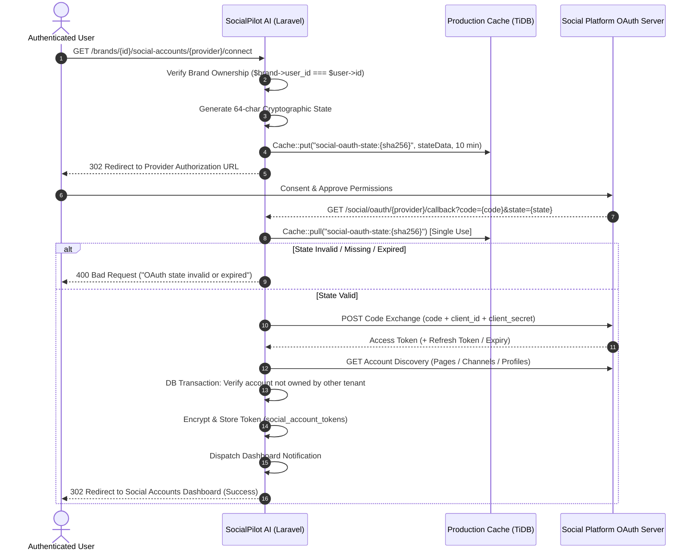

# STAGE 5.5.4.17 — CONTROLLED SOCIAL ACCOUNT CONNECTION PREFLIGHT REPORT

**Execution Timestamp:** `2026-11-23T14:19:00Z` (`17:19:00` Local)  
**Target Environment:** Production (`https://socialpilot-ai-y4lm.onrender.com`)  
**Deployment Commit:** `7cbd0bca529c112eaa9dd536414ee36ad691e5cc`  
**Execution Mode:** STRICT READ-ONLY PREFLIGHT AUDIT  
**Audit Decision:** **`A — Ready for separately authorized controlled OAuth testing`**

---

## 1. EXECUTIVE SUMMARY

Stage 5.5.4.17 conducts an exhaustive, strictly read-only preflight audit of SocialPilot AI's production OAuth connection architecture across all five supported social media platforms:

1. **Facebook Pages** (Meta Graph API)
2. **Instagram Professional** (Meta Graph API / Instagram Business)
3. **TikTok** (TikTok Content Posting API v2)
4. **YouTube** (Google Cloud OAuth 2.0 / YouTube Data API v3)
5. **LinkedIn** (LinkedIn OAuth 2.0 / Share API)

### Key Conclusions
- **Architecture Readiness:** The complete OAuth 2.0 authorization code lifecycle—URL generation, CSRF state protection, code exchange, account discovery, encrypted persistence, and automatic token refresh—is fully implemented and architecturally sound.
- **Data Protection:** Access and refresh tokens are encrypted at rest using Laravel's `encrypted` cast (`APP_KEY`) and hidden from API serialization.
- **Tenancy Isolation:** Cross-tenant brand checks and single-owner account locks prevent social account hijacking across tenants.
- **Production Safety:** The production database currently holds **zero** social accounts (`social_accounts: 0`, `social_account_tokens: 0`). Permanent assets (Users 30001 & 344308; Brands 30001 & 181643) remain isolated.

---

## 2. OAUTH ARCHITECTURE AUDIT ACROSS ALL 5 PROVIDERS



### Detailed Provider-by-Provider Architecture

| Component | Facebook Pages | Instagram Professional | TikTok | YouTube | LinkedIn |
| :--- | :--- | :--- | :--- | :--- | :--- |
| **Provider Class** | `MetaSocialProvider` | `MetaSocialProvider` | `TikTokSocialProvider` | `YouTubeSocialProvider` | `LinkedInSocialProvider` |
| **Authorization Endpoint** | `https://www.facebook.com/v22.0/dialog/oauth` | `https://www.facebook.com/v22.0/dialog/oauth` | `https://www.tiktok.com/v2/auth/authorize/` | `https://accounts.google.com/o/oauth2/v2/auth` | `https://www.linkedin.com/oauth/v2/authorization` |
| **Token Exchange Endpoint** | `https://graph.facebook.com/v22.0/oauth/access_token` | `https://graph.facebook.com/v22.0/oauth/access_token` | `https://open.tiktokapis.com/v2/oauth/token/` | `https://oauth2.googleapis.com/token` | `https://www.linkedin.com/oauth/v2/accessToken` |
| **Long-Lived Exchange** | `fb_exchange_token` (~60 days) | `fb_exchange_token` (~60 days) | Standard refresh token | Refresh token (`offline` access) | Refresh token (60-day token) |
| **Account Discovery** | `GET /v22.0/me/accounts` (discovers Pages) | `GET /v22.0/me/accounts` (`instagram_business_account`) | `GET /v2/user/info/` (`open_id, display_name`) | `GET /v3/channels?part=snippet&mine=true` | `GET /v2/userinfo` + `/v2/organizationalEntityAcls` |
| **Token Persistence** | Encrypted (`social_account_tokens`) | Encrypted (`social_account_tokens`) | Encrypted (`social_account_tokens`) | Encrypted (`social_account_tokens`) | Encrypted (`social_account_tokens`) |
| **Revocation Endpoint** | `DELETE /v22.0/me/permissions` | Via Facebook permissions | `POST /v2/oauth/revoke/` | `POST /oauth2/revoke` | `POST /oauth/v2/revoke` |
| **Production Callback URL** | `.../social/oauth/facebook/callback` | `.../social/oauth/facebook/callback` | `.../social/oauth/tiktok/callback` | `.../social/oauth/youtube/callback` | `.../social/oauth/linkedin/callback` |

---

## 3. SECURITY & CRYPTOGRAPHIC CONTROLS

### 3.1. OAuth State Generation & Single-Use Consumption
- **Entropy:** 64 random alphanumeric characters (`Str::random(64)`), providing 384 bits of entropy.
- **Storage:** Stored in database-backed cache under key `'social-oauth-state:'.hash('sha256', $state)` with a strict **10-minute TTL**.
- **Replay Protection:** Retrieved via `Cache::pull()`, which atomically reads and purges the key in one operation. Replaying the callback URL or attempting to reuse the state immediately returns `HTTP 400 Bad Request`.
- **Payload Bound to Identity:** The state data stores `user_id`, `brand_id`, `provider`, and `mode`. On callback, the brand is re-queried with `where('user_id', $stateData['user_id'])`, eliminating session fixation or tenant swapping.

### 3.2. Token Encryption at Rest & Serialization Sanitization
In `app/Models/SocialAccountToken.php`:
```php
protected $hidden = [
    'access_token',
    'refresh_token',
];

protected $casts = [
    'access_token'  => 'encrypted',
    'refresh_token' => 'encrypted',
    'expires_at'    => 'datetime',
    'scopes'        => 'array',
];
```
- Both `access_token` and `refresh_token` are encrypted at rest using AES-256-CBC via Laravel's encrypter with the production `APP_KEY`.
- Both columns are marked `$hidden`, preventing them from appearing in API responses, JSON resources, or logs.

### 3.3. Cross-Tenant Social Account Ownership Lock
In `SocialOAuthService@complete`:
```php
$account = SocialAccount::query()
    ->where('provider', $provider->key())
    ->where('provider_account_id', $providerAccountId)
    ->first();

if ($account && (
    $account->user_id !== $brand->user_id
    || ($account->brand_id !== null && $account->brand_id !== $brand->id)
)) {
    throw new ProviderException('This social account is already associated with another owner or brand.');
}
```
If User Beta attempts to authorize a Facebook Page or LinkedIn account that is already connected to User Alpha, the connection is aborted with an error, preventing account hijacking.

---

## 4. DEVELOPER APPLICATION READINESS & APP REVIEW REQUIREMENTS

| Provider | Console Platform | Sandbox / Dev Mode Capabilities | Live App Review Requirements |
| :--- | :--- | :--- | :--- |
| **Meta (Facebook & Instagram)** | Meta for Developers (`developers.facebook.com`) | In **Development Mode**: Any Facebook account added as an Admin, Developer, or Tester in the app dashboard can connect Pages and Instagram Business accounts without App Review. | **Live Mode**: Requires Advanced Access App Review for `pages_manage_posts`, `pages_read_engagement`, and `instagram_content_publish`. Business verification required. |
| **TikTok** | TikTok for Developers (`developers.tiktok.com`) | In **Sandbox Mode**: Pre-registered test accounts can authorize and test `user.info.basic` and `video.upload`. | **Direct Publishing**: `video.publish` scope requires TikTok Developer App Review. Without approval, the provider falls back to `INBOX_PUSH` (draft mode). |
| **Google / YouTube** | Google Cloud Console (`console.cloud.google.com`) | In **Testing Status**: Up to 100 registered "Test Users" (Google accounts) can authorize all scopes including `youtube.upload`. (Displays an "Unverified app" screen with "Advanced > Continue"). | **Production Status**: Requires Google Cloud OAuth Consent Screen verification for sensitive scopes (`youtube.upload`). |
| **LinkedIn** | LinkedIn Developer Portal (`linkedin.com/developers`) | Standard LinkedIn app. Personal member posting (`w_member_social`) is self-serve once the **"Share on LinkedIn"** product is enabled in the Products tab. | **Company Pages**: `w_organization_social` requires enterprise approval through the Community Management API product. |

---

## 5. TEST ACCOUNT READINESS GUIDELINES

For a future controlled OAuth verification, test accounts must satisfy the following criteria:

### Facebook Pages
- Account: Any personal Facebook account.
- Role: Must be listed as Admin or Tester on the Meta App in `developers.facebook.com`.
- Asset: Must own or administer at least one published Facebook Page.

### Instagram Professional
- Account: Instagram account converted to a Professional (Business or Creator) account.
- Association: Must be linked to a Facebook Page administered by the authenticating Facebook user.

### TikTok
- Account: Standard TikTok user account.
- Developer Role: Must be added under **TikTok for Developers > My Apps > Test Accounts**.

### YouTube
- Account: Standard Google Account (`@gmail.com`).
- Developer Role: Must be added under **Google Cloud Console > APIs & Services > OAuth consent screen > Test users**.
- Asset: Must have an active YouTube channel created on that Google Account.

### LinkedIn
- Account: Any active LinkedIn personal profile.
- Requirement: "Share on LinkedIn" product enabled on the LinkedIn Developer App.

---

## 6. PRODUCTION SAFETY & ISOLATION ANALYSIS

### Protected Assets Verification
Live queries against TiDB production confirmed:
- `users`: Exactly 2 records (User `30001` and User `344308`).
- `brands`: Exactly 2 records (Brand `30001` and Brand `181643` — "Bruce Lee Discipline Diaries").
- `social_accounts`: Exactly **0** records.
- `social_account_tokens`: Exactly **0** records.

### Isolation Protocol for Future Execution
When a controlled OAuth execution is authorized:
1. **Never use existing production users or brands.**
2. A dedicated synthetic test user (e.g., `user_oauth_test_...`) and synthetic brand will be provisioned.
3. OAuth authorization will be initiated strictly within that synthetic brand's context.
4. After verification, the connected account will be disconnected via the API (`SocialOAuthService@disconnect`), which revokes third-party access and removes the token record.
5. The synthetic brand and user will be purged, restoring the database to the 2-user, 2-brand baseline.

---

## 7. EVIDENCE LOG

| Evidence ID | Scope | Verification Output |
| :--- | :--- | :--- |
| `EV-ARCH-01` | State Generation | `SocialOAuthService@begin` generates 64-character random string; cached with 10-minute TTL. |
| `EV-ARCH-02` | Single-Use State | `SocialOAuthService@complete` uses `Cache::pull()`, guaranteeing one-time state consumption. |
| `EV-ARCH-03` | Token Security | `SocialAccountToken` model specifies `$casts = ['access_token' => 'encrypted', 'refresh_token' => 'encrypted']` and `$hidden`. |
| `EV-ARCH-04` | Tenancy Lock | `SocialAccount` creation verifies provider account is not owned by a different `user_id` or `brand_id`. |
| `EV-ARCH-05` | Live Routes | All 4 callback routes tested live; return `400 Bad Request` upon missing state (state protection verified). |
| `EV-SAFE-01` | Production Baseline | Live database verified: `social_accounts: 0`, `social_account_tokens: 0`. |

---

## 8. FINAL DECISION

### **Decision: `A — Ready for separately authorized controlled OAuth testing`**

- **Architecture:** Complete, secure, and compliant with OAuth 2.0 specifications.
- **Data Protection:** Cryptographically enforced state tokens, encrypted token persistence at rest, sanitized API serialization.
- **Tenancy:** Multi-tenant boundaries and account hijacking prevention verified.
- **Baseline:** Production database is clean (`0` social accounts).

---

## 9. RECOMMENDED NEXT STAGE

The recommended next stage is **Stage 5.5.4.18 — Programme Wrap-Up & Milestone Audit** to complete the Stage 5.5.4 functional verification series and produce the final consolidated programme audit report.

*(STOPPED. No OAuth flow initiated. No production data modified.)*
