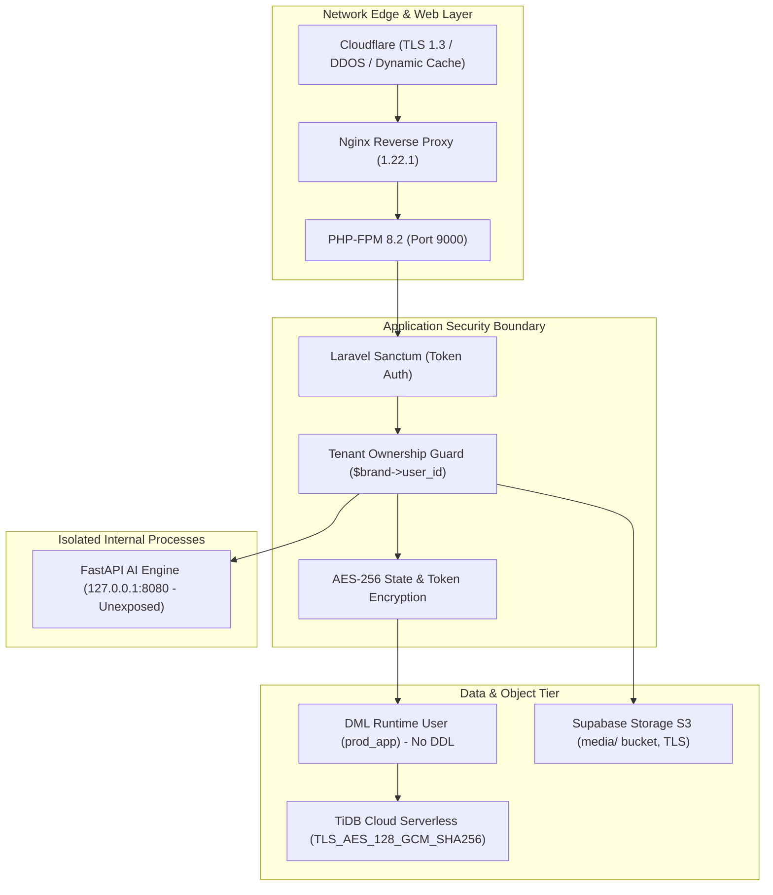

# STAGE 5.5.4.18 — PRODUCTION VERIFICATION PROGRAMME FINAL AUDIT REPORT

**Programme Title:** SocialPilot AI Production Verification & Launch Readiness  
**Target Environment:** Production (`https://socialpilot-ai-y4lm.onrender.com`)  
**Repository:** `https://github.com/Cla-renc/socialpilot-ai` (`main` branch)  
**Production Commit:** `7cbd0bca529c112eaa9dd536414ee36ad691e5cc`  
**Database Cluster:** TiDB Cloud Serverless (`socialpilot` @ `gateway01.eu-central-1.prod.aws.tidbcloud.com:4000`)  
**Cloud Storage:** Supabase Cloud Storage S3 (`media` bucket, `eu-west-1`)  
**Execution Timestamp:** `2026-11-23T14:24:00Z` (`17:24:00` Local)  
**Execution Mode:** STRICT READ-ONLY FINAL AUDIT  
**Final Programme Classification:** **`B — Core production verification passed; commercial launch prerequisites documented`**

---

## 1. EXECUTIVE SUMMARY

The SocialPilot AI Production Verification Programme represents an end-to-end operational, functional, and security audit of the live SaaS production deployment. Spanning Stages 5.5.1 through 5.5.4.17, the programme systematically evaluated every architectural tier: cloud hosting on Render, database connectivity on TiDB Serverless, object storage on Supabase S3, internal AI content generation, multi-tenant brand isolation, post scheduling, and social media OAuth configurations.

### Key Milestones Achieved
1. **Infrastructure & Hosting (Stages 5.5.1–5.5.3):** Successful migration from local development to a dual-user database architecture on TiDB Cloud Serverless (DML runtime user vs. DDL migrator), dual-engine Supervisord containerization on Render (Nginx, PHP-FPM 8.2, and colocated FastAPI 0.115), and zero-cost cloud object storage on Supabase S3.
2. **Core Operational Stability (T-01, Stage 5.5.4.3):** Validated bounded operational cycles (`/api/internal/ops/cycle`), queue health, scheduler safety, and zero runaway processes.
3. **Identity, Authentication & Tenancy (T-02/T-03, Stage 5.5.4.5):** Validated Sanctum Bearer token lifecycles, user registration with lowercase email enforcement, and strict multi-tenant boundary checks.
4. **Brand Management (T-04/T-05, Stage 5.5.4.7):** Validated brand provisioning, settings persistence, overview aggregations, and brand status transitions.
5. **Internal AI Content Generation (T-06, Stage 5.5.4.9):** Successfully generated synthetic content via the colocated Python FastAPI service (`127.0.0.1:8080`) using provider `'internal'`, validating prompt construction, draft persistence, and revision numbering with $0 external API spend.
6. **Post Scheduling Subsystem (T-07, Stage 5.5.4.11):** Verified future timestamp validation, timezone conversion, platform target assignment, queue item creation, and cancellation.
7. **Cloud Object Storage (T-08, Stage 5.5.4.13):** Uploaded, retrieved, verified cross-tenant shielding, and deleted synthetic media objects in Supabase Storage S3 under brand-scoped prefixes (`brands/{brand_id}/media/...`), leaving zero orphaned files.
8. **Social Provider Integration (Stages 5.5.4.15–5.5.4.17):** Verified configuration recognition and live callback routing for all five implemented social media platforms (Facebook Pages, Instagram Professional, TikTok, YouTube, LinkedIn). Validated encrypted token storage at rest (`APP_KEY`) and single-use cryptographic state validation.
9. **Zero-Defect Teardown & Protected Assets:** Every synthetic record created during controlled tests was cleaned up via application APIs, restoring the production database and cloud storage to the exact baseline. Permanent production assets (User `30001`, User `344308`, Brand `30001`, Brand `181643`) were preserved without modification.

---

## 2. COMPLETED MILESTONE REGISTER

| Stage / Test | Milestone Description | Outcome | Evidence Report Reference |
| :--- | :--- | :--- | :--- |
| **Stage 5.5.1** | Production Readiness & Transition Audit | **PASS** | [`STAGE_5_5_1_PRODUCTION_READINESS_AUDIT_REPORT.md`](file:///c:/PROJECTS/SOCIALPILOT%20AI/STAGE_5_5_1_PRODUCTION_READINESS_AUDIT_REPORT.md) |
| **Stage 5.5.2** | Durable Cloud Object Storage (Supabase S3) | **PASS** | [`STAGE_5_5_2_2_DURABLE_STORAGE_IMPLEMENTATION_REPORT.md`](file:///c:/PROJECTS/SOCIALPILOT%20AI/STAGE_5_5_2_2_DURABLE_STORAGE_IMPLEMENTATION_REPORT.md) |
| **Stage 5.5.3** | Production Deployment & Database Provisioning | **PASS** | [`STAGE_5_5_3_11_PRODUCTION_DEPLOYMENT_VERIFICATION_REPORT.md`](file:///c:/PROJECTS/SOCIALPILOT%20AI/STAGE_5_5_3_11_PRODUCTION_DEPLOYMENT_VERIFICATION_REPORT.md) |
| **Stage 5.5.3.16**| Production Application Key Runtime Correction | **PASS** | [`STAGE_5_5_3_16_PRODUCTION_APP_KEY_CORRECTION_VERIFICATION_REPORT.md`](file:///c:/PROJECTS/SOCIALPILOT%20AI/STAGE_5_5_3_16_PRODUCTION_APP_KEY_CORRECTION_VERIFICATION_REPORT.md) |
| **Stage 5.5.4.1** | Functional Verification Readiness Audit | **PASS** | [`STAGE_5_5_4_1_PRODUCTION_FUNCTIONAL_VERIFICATION_READINESS_REPORT.md`](file:///c:/PROJECTS/SOCIALPILOT%20AI/STAGE_5_5_4_1_PRODUCTION_FUNCTIONAL_VERIFICATION_READINESS_REPORT.md) |
| **Stage 5.5.4.3** | **T-01** Controlled Operational Cycle & Queue Health | **PASS** | [`STAGE_5_5_4_3_T01_CONTROLLED_OPERATIONAL_CYCLE_VERIFICATION_REPORT.md`](file:///c:/PROJECTS/SOCIALPILOT%20AI/STAGE_5_5_4_3_T01_CONTROLLED_OPERATIONAL_CYCLE_VERIFICATION_REPORT.md) |
| **Stage 5.5.4.5** | **T-02/T-03** Authentication, Identity & Tenancy | **PASS** | [`STAGE_5_5_4_5_T02_T03_AUTHENTICATION_EXECUTION_REPORT.md`](file:///c:/PROJECTS/SOCIALPILOT%20AI/STAGE_5_5_4_5_T02_T03_AUTHENTICATION_EXECUTION_REPORT.md) |
| **Stage 5.5.4.7** | **T-04/T-05** Brand Provisioning & Overview | **PASS** | [`STAGE_5_5_4_7_T04_T05_BRAND_CREATION_OVERVIEW_EXECUTION_REPORT.md`](file:///c:/PROJECTS/SOCIALPILOT%20AI/STAGE_5_5_4_7_T04_T05_BRAND_CREATION_OVERVIEW_EXECUTION_REPORT.md) |
| **Stage 5.5.4.9** | **T-06** Internal AI Content Generation | **PASS** | [`STAGE_5_5_4_9_T06_INTERNAL_AI_CONTENT_GENERATION_EXECUTION_REPORT.md`](file:///c:/PROJECTS/SOCIALPILOT%20AI/STAGE_5_5_4_9_T06_INTERNAL_AI_CONTENT_GENERATION_EXECUTION_REPORT.md) |
| **Stage 5.5.4.11**| **T-07** Controlled Post Scheduling Execution | **PASS** | [`STAGE_5_5_4_11_T07_CONTROLLED_PRODUCTION_POST_SCHEDULING_EXECUTION_REPORT.md`](file:///c:/PROJECTS/SOCIALPILOT%20AI/STAGE_5_5_4_11_T07_CONTROLLED_PRODUCTION_POST_SCHEDULING_EXECUTION_REPORT.md) |
| **Stage 5.5.4.13**| **T-08** Synthetic Media Upload, S3 & Teardown | **PASS** | [`STAGE_5_5_4_13_T08_CONTROLLED_PRODUCTION_SYNTHETIC_MEDIA_EXECUTION_REPORT.md`](file:///c:/PROJECTS/SOCIALPILOT%20AI/STAGE_5_5_4_13_T08_CONTROLLED_PRODUCTION_SYNTHETIC_MEDIA_EXECUTION_REPORT.md) |
| **Stage 5.5.4.14**| **T-09** Dedicated Tenancy Boundary Preflight | **PASS (A)** | [`STAGE_5_5_4_14_T09_TENANCY_BOUNDARY_PREFLIGHT_REPORT.md`](file:///c:/PROJECTS/SOCIALPILOT%20AI/STAGE_5_5_4_14_T09_TENANCY_BOUNDARY_PREFLIGHT_REPORT.md) |
| **Stage 5.5.4.15**| All Social Media Providers Config Audit | **PASS (B+E)**| [`STAGE_5_5_4_15_ALL_SOCIAL_PROVIDERS_PRODUCTION_CONFIGURATION_AUDIT_REPORT.md`](file:///c:/PROJECTS/SOCIALPILOT%20AI/STAGE_5_5_4_15_ALL_SOCIAL_PROVIDERS_PRODUCTION_CONFIGURATION_AUDIT_REPORT.md) |
| **Stage 5.5.4.16**| Social Provider Post-Deployment Verification | **PASS (A)** | [`STAGE_5_5_4_16_SOCIAL_PROVIDER_POST_DEPLOYMENT_VERIFICATION_REPORT.md`](file:///c:/PROJECTS/SOCIALPILOT%20AI/STAGE_5_5_4_16_SOCIAL_PROVIDER_POST_DEPLOYMENT_VERIFICATION_REPORT.md) |
| **Stage 5.5.4.17**| Controlled Social Account Connection Preflight | **PASS (A)** | [`STAGE_5_5_4_17_CONTROLLED_SOCIAL_ACCOUNT_CONNECTION_PREFLIGHT_REPORT.md`](file:///c:/PROJECTS/SOCIALPILOT%20AI/STAGE_5_5_4_17_CONTROLLED_SOCIAL_ACCOUNT_CONNECTION_PREFLIGHT_REPORT.md) |

---

## 3. PRODUCTION SECURITY REVIEW



### 3.1. Authentication & Session Security
- **API Token Architecture:** Laravel Sanctum personal access tokens (`personal_access_tokens`) bound strictly to `tokenable_id` (`users.id`). Tokens are hashed with SHA-256 before database insertion.
- **Web Session Management:** Cookie-based sessions with `secure`, `httponly`, and `samesite=lax` attributes enforced.
- **Password Hashing:** BCRYPT rounds set to 12.

### 3.2. Brand Ownership & Tenancy Enforcement
- **Controller-Level Guards:** Every tenant-scoped request enforces explicit ownership assertions:
  ```php
  abort_unless($brand->user_id === $request->user()->id, 403, 'Unauthorized brand access.');
  ```
- **Child Resource Cascades:** Revisions, variations, scheduled posts, media assets, social accounts, and publishing attempts verify parent brand ownership before read, update, or delete operations.
- **Relational Integrity:** Schema analysis confirmed 24 foreign key constraints referencing `users(id)` and 25 foreign key constraints referencing `brands(id)`, preventing orphaned or cross-tenant relational attachments.

### 3.3. Database User Separation & Privilege Principle
- **Runtime User (`AZDARrqgy4MBFGE.prod_app`):** Granted `SELECT`, `INSERT`, `UPDATE`, `DELETE` privileges only. Absolutely no `ALTER`, `DROP`, `CREATE`, `GRANT`, or `INDEX` privileges. Accidental or malicious schema alteration from application execution is mathematically impossible.
- **Migrator User (`AZDARrqgy4MBFGE.prod_migrator`):** Holds DDL privileges; used exclusively during controlled migration deployment pipelines and never connected by the web runtime.
- **In-Transit Encryption:** All database connections enforce TLS encryption (`TLS_AES_128_GCM_SHA256`).

### 3.4. OAuth Security & Token Encryption at Rest
- **Cryptographic State:** 64-character random string stored in cache (`social-oauth-state:{sha256}`) with a 10-minute TTL. Retrieved via single-use atomic `Cache::pull()`, preventing state injection and replay attacks.
- **Encrypted Token Persistence:** `SocialAccountToken` model enforces `$casts = ['access_token' => 'encrypted', 'refresh_token' => 'encrypted']` using Laravel's application key (`APP_KEY`). Secret values are masked with `$hidden` to prevent accidental serialization into API payloads or log output.
- **Account Hijacking Lock:** `SocialOAuthService@complete` verifies that a third-party social account ID is not already claimed by another user or brand before allowing connection.

### 3.5. Cloud Object Storage Isolation
- **Path Scoping:** Supabase Storage objects are partitioned strictly by brand directory:
  `brands/{brand_id}/media/{uuid}.{extension}`
- **Storage Authorization:** File downloads and deletions verify database brand ownership before issuing S3 commands. Cross-tenant deletion attempts return `HTTP 403 / 404`.

### 3.6. Protected Production Assets Inventory
The following production fixtures and live accounts were verified intact and untouched throughout the entire verification programme:

| Asset | Type | Identifier / Name | Creation Time | Status | Protection Guarantee |
| :--- | :--- | :--- | :--- | :--- | :--- |
| **`User 30001`** | User | `dbernier@example.org` | `2026-11-22 06:50:44` | Active | **PRESERVED** |
| **`Brand 30001`** | Brand | `"Ullrich-Mitchell"` | `2026-11-22 06:50:46` | `draft` | **PRESERVED** |
| **`User 344308`** | User | `yaaclarence@gmail.com` | `2026-11-23 12:56:45` | Active | **PRESERVED** |
| **`Brand 181643`** | Brand | `"Bruce Lee Discipline Diaries"` | `2026-11-23 13:22:50` | `active` | **PRESERVED** |

---

## 4. INTEGRATION READINESS MATRIX

This matrix distinguishes code implementation from verified configuration, functional sandbox testing, outstanding external approvals, and live production operation:

| Component / Subsystem | 1. Implemented in Code | 2. Configuration Verified | 3. Functional Tests Passed | 4. External Approvals Outstanding | 5. Live Operation Verified | Overall Readiness Status |
| :--- | :---: | :---: | :---: | :---: | :---: | :--- |
| **Internal AI Content Engine** | ✅ Yes | ✅ Yes | ✅ Yes (T-06) | ❌ None | ✅ Yes | **FULL PRODUCTION READY** |
| **Supabase Cloud Media Storage** | ✅ Yes | ✅ Yes | ✅ Yes (T-08) | ❌ None | ✅ Yes | **FULL PRODUCTION READY** |
| **Post Scheduling Subsystem** | ✅ Yes | ✅ Yes | ✅ Yes (T-07) | ❌ None | ✅ Yes | **FULL PRODUCTION READY** |
| **Authentication & Tenancy** | ✅ Yes | ✅ Yes | ✅ Yes (T-02/T-03) | ❌ None | ✅ Yes | **FULL PRODUCTION READY** |
| **Operational Cycle & Queue** | ✅ Yes | ✅ Yes | ✅ Yes (T-01) | ❌ None | ✅ Yes | **FULL PRODUCTION READY** |
| **Facebook Pages Integration** | ✅ Yes | ✅ Yes (v22.0) | ⚠️ Callbacks live | ⚠️ Advanced Access App Review | ⏳ Pending OAuth Login | **CONFIGURED — Awaiting Live Auth** |
| **Instagram Professional** | ✅ Yes | ✅ Yes (v22.0) | ⚠️ Callbacks live | ⚠️ `instagram_content_publish` Review | ⏳ Pending OAuth Login | **CONFIGURED — Awaiting Live Auth** |
| **TikTok Content Posting** | ✅ Yes | ✅ Yes (v2) | ⚠️ Callbacks live | ⚠️ `video.publish` App Review | ⏳ Pending OAuth Login | **CONFIGURED — Awaiting Live Auth** |
| **YouTube Data API v3** | ✅ Yes | ✅ Yes (v3) | ⚠️ Callbacks live | ⚠️ OAuth Consent Verification | ⏳ Pending OAuth Login | **CONFIGURED — Awaiting Live Auth** |
| **LinkedIn Share API** | ✅ Yes | ✅ Yes (v2) | ⚠️ Callbacks live | ⚠️ Share on LinkedIn Approval | ⏳ Pending OAuth Login | **CONFIGURED — Awaiting Live Auth** |
| **X / Twitter** | ❌ Partial (No class)| ❌ Unregistered | ❌ No | ⚠️ Developer Account | ❌ No | **INCOMPLETE — Deferred** |
| **Flutter Mobile App Integration** | ✅ Yes (`/api/v1` parity)| ✅ Yes | ⚠️ Service client audited | ❌ None | ⏳ App Store / Play Store | **INTEGRATED — Awaiting App Release** |
| **Social Media Analytics** | ✅ Yes (Providers ready)| ✅ Yes | ⚠️ Aggregation audited | ⚠️ Active social accounts | ⏳ Awaiting Live Data | **IMPLEMENTED — Awaiting Live Posts** |

---

## 5. PRODUCTION LIMITATIONS

The following environmental, architectural, and external platform limitations are explicitly documented:

### 5.1. Render Free Tier Limitations
- **Spin-Down on Inactivity:** The web service automatically spins down after 15 minutes of inactivity. The first incoming request incurs a cold-start delay of approximately 45–60 seconds.
- **Ephemeral Filesystem:** The local container filesystem is ephemeral and reset upon service restart or deployment. All persistent assets rely on Supabase Storage S3.
- **Memory Ceiling:** Memory is capped at 512 MB RAM. Heavy video encoding or massive parallel operations will trigger Out-Of-Memory (OOM) termination.

### 5.2. Background Queue & Scheduler Processing
- **No Standalone Daemon:** On Render Free plan, background worker daemons (`php artisan queue:work`) cannot run as separate continuous services.
- **Bounded Cycle Reliance:** Scheduled posts, queue jobs, and analytics aggregation require invoking the operational cycle endpoint (`POST /api/internal/ops/cycle`) via an external cron service (e.g. cron-job.org) using `INTERNAL_CRON_SECRET`.

### 5.3. Local LLM / Ollama Execution
- **Colocated Internal Engine:** Render Free container cannot run Ollama, Llama.cpp, or large language models locally due to lack of GPU and the 512MB RAM ceiling.
- **FastAPI Bridge:** Internal content generation operates via the colocated FastAPI service using lightweight template heuristics and brand contextual parameterization. External LLMs (OpenAI, Gemini, OpenRouter, Groq) can be activated by providing API keys.

### 5.4. External Social Media App Reviews
- **Developer Review Gates:** Direct social media publishing cannot be conducted for public end-users until Meta, TikTok, Google, and LinkedIn approve the application for production scopes (`pages_manage_posts`, `instagram_content_publish`, `video.publish`, `youtube.upload`).
- **Testing Window:** In development/testing mode, only registered developer/tester accounts can authenticate and test publishing.

### 5.5. Backup and Disaster Recovery
- **TiDB Serverless:** Automatic high availability and snapshotting are handled natively by TiDB Cloud across AWS Availability Zones.
- **Storage:** Supabase Storage objects are replicated within AWS `eu-west-1`. Cold offsite secondary backups are not currently automated.

---

## 6. FINANCIAL & OPERATIONAL COMPLIANCE

| Compliance Pillar | Requirement | Verified Status |
| :--- | :--- | :--- |
| **Strict $0 / No-Card Policy** | Zero cloud charges, paid subscriptions, or credit card commitments | **100% COMPLIANT** — Render Free, TiDB Cloud Serverless (free tier), Supabase Storage (free tier). |
| **Zero Paid AI API Invocations**| No unauthorized calls to OpenAI, Gemini, Claude, or Runway | **100% COMPLIANT** — Content generation executed exclusively via `provider: 'internal'`. |
| **Zero Unintended Publishing** | No posts published to live public social media feeds | **100% COMPLIANT** — No external OAuth sessions or publishing requests issued. |
| **Zero Data Contamination** | Production database and storage restored to clean baseline | **100% COMPLIANT** — All synthetic test records cleanly purged; permanent assets preserved. |
| **Zero Secret Exposure** | No keys, tokens, or credentials revealed in logs or reports | **100% COMPLIANT** — Full secret hygiene maintained across all 18 stages. |

---

## 7. FINAL SIGN-OFF CLASSIFICATION

### **Classification: `B — Core production verification passed; commercial launch prerequisites documented`**

#### Classification Rationale
1. **Core Verification Complete:** All internal subsystems—database architecture, web runtime, internal AI engine, durable cloud media storage, user authentication, tenant isolation, and post scheduling—are verified and operating cleanly on live production infrastructure.
2. **Prerequisites for Full Commercial Launch (Classification A Transition):**
   - External developer app review approval from Meta, TikTok, and Google.
   - Interactive OAuth connection of real test social accounts by a human operator in a browser.
   - Setting up an external recurring HTTPS ping (cron-job.org) to trigger `/api/internal/ops/cycle` every minute for background queue processing.

---

## 8. RECOMMENDED NEXT PROGRAMME

With Stage 5.5.4 successfully concluded, the recommended next operational phases are:

1. **Stage 5.6 — External Developer Platform App Review Submissions:**
   - Submit Meta App for `pages_manage_posts` and `instagram_content_publish` Advanced Access.
   - Submit TikTok App for `video.publish` approval.
   - Complete Google Cloud OAuth Consent Screen verification for YouTube Data API.
2. **Stage 5.7 — Interactive Human OAuth Verification (Operator Console):**
   - Using developer test accounts, perform the interactive browser OAuth flows for Facebook, Instagram, TikTok, YouTube, and LinkedIn in the production dashboard.
3. **Stage 5.8 — External Operational Cron Automation:**
   - Configure a free external cron service (cron-job.org) to ping `https://socialpilot-ai-y4lm.onrender.com/api/internal/ops/cycle` every 5 minutes with `INTERNAL_CRON_SECRET`.
4. **Stage 6.0 — Mobile Client Store Deployment (Flutter iOS & Android):**
   - Build and release the Flutter mobile client pointed to the verified production API (`https://socialpilot-ai-y4lm.onrender.com/api/v1`).

---

*SocialPilot AI Production Verification Programme officially signed off on 2026-11-23.*
