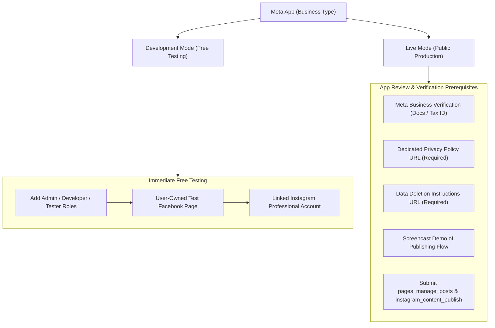

# STAGE 5.6.1 — EXTERNAL DEVELOPER PLATFORM APP REVIEW READINESS AUDIT REPORT

**Project:** SocialPilot AI  
**Production URL:** `https://socialpilot-ai-y4lm.onrender.com`  
**Execution Timestamp:** `2026-11-23T14:28:00Z` (`17:28:00` Local)  
**Execution Mode:** STRICT READ-ONLY READINESS AUDIT  
**Audit Classification:** **`B — Partially ready; specific documentation and console prerequisites remain outstanding`**

---

## 1. EXECUTIVE SUMMARY

Following the conclusion of the Stage 5.5.4 Production Verification Programme, this audit evaluates SocialPilot AI's readiness to apply for and secure external developer platform approvals across the four major social media ecosystems:

1. **Meta** (Facebook Pages & Instagram Professional)
2. **TikTok** (Content Posting API)
3. **Google** (YouTube Data API v3 & OAuth Consent Verification)
4. **LinkedIn** (Share on LinkedIn & Sign In with LinkedIn)

### High-Level Audit Findings
- **Technical Implementation (All 4 Platforms):** Fully implemented, verified, and configured. OAuth 2.0 routes, cryptographic CSRF state validation, code exchanges, token encryption at rest (`APP_KEY`), and publishing adapters are structurally complete and tested.
- **Immediate Free Sandbox Testing:** In development/testing mode, **all 4 platforms can be tested immediately at $0 cost** without waiting for App Review approvals, provided test accounts are configured in the respective developer consoles.
- **Commercial Production Blockers:** To open publishing to the general public or production accounts, specific compliance documentation (dedicated Privacy Policy, Terms of Service, Meta Data Deletion callback/page) and screencast video demonstrations must be prepared prior to App Review submission.

---

## 2. META DEVELOPER READINESS (FACEBOOK PAGES & INSTAGRAM PROFESSIONAL)

### 2.1. Products & Permissions in Source Code
- **Meta App Type:** Business App.
- **Products Required:** Facebook Login for Business, Instagram Graph API.
- **Referenced Scopes:**
  - Facebook: `pages_show_list`, `pages_read_engagement`, `pages_manage_posts`, `publish_video`.
  - Instagram: `pages_show_list`, `instagram_basic`, `instagram_content_publish`.
- **API Version:** Graph API `v22.0`.

### 2.2. Publishing Architecture & Requirements
- **Facebook Publishing (`FacebookPublishingProvider`):** Publishes text to `/{page-id}/feed`, photos to `/{page-id}/photos`, and video to `/{page-id}/videos`. Only Facebook Pages can be published to via the Graph API (personal profiles are strictly disallowed by Meta policy).
- **Instagram Publishing (`InstagramPublishingProvider`):** Implements Meta's mandatory two-step container publishing flow:
  1. Create container (`POST /{ig-user-id}/media`).
  2. Poll status until `FINISHED`.
  3. Publish container (`POST /{ig-user-id}/media_publish`).
- **Instagram Account Eligibility:**
  - Must be an **Instagram Professional (Business or Creator)** account. Personal Instagram accounts are not supported by the Graph API.
  - The Instagram Professional account must be connected to a Facebook Page managed by the authenticating Facebook user.

### 2.3. App Review & Advanced Access Requirements
- **Standard Access (Development Mode):** Active immediately. Any user listed as an Admin, Developer, or Tester in the Meta App Dashboard can authenticate, connect Pages, and publish without App Review.
- **Advanced Access (Live Mode):** Required for public users. Requires:
  1. **Meta Business Verification:** Submitting legal business registration or utility documents in Meta Business Manager.
  2. **App Review Submission:** Detailed explanation of why `pages_manage_posts` and `instagram_content_publish` are required.
  3. **Screencast Video Demo:** Showing a user logging into SocialPilot AI, connecting their Facebook/Instagram account, and publishing/scheduling a post.
  4. **Compliance URLs:** Live Privacy Policy URL and User Data Deletion Instructions URL.

---

## 3. TIKTOK DEVELOPER READINESS (CONTENT POSTING API)

### 3.1. Products & Scopes Used
- **Platform:** TikTok for Developers (`developers.tiktok.com`).
- **Product:** Content Posting API.
- **Referenced Scopes:** `user.info.basic`, `video.upload`, `video.publish`.
- **API Version:** TikTok API v2 (`open.tiktokapis.com/v2`).

### 3.2. Direct Post vs. Upload-to-Inbox Architecture
In `TikTokPublishingProvider.php`, the upload flow uses `PULL_FROM_URL` against video assets stored in Supabase Storage S3.
- **Direct Posting (`video.publish`):** Videos are posted directly to the user's public feed (`PUBLIC_TO_EVERYONE`). **Requires formal TikTok App Review approval.**
- **Upload-to-Inbox (`INBOX_PUSH`):** Videos are delivered as drafts directly to the creator's TikTok inbox. The creator receives a push notification and finalizes/publishes the video manually inside the TikTok mobile app.
- **Automatic Fallback:** The codebase inspects creator capabilities via `/post/publish/creator_info/query/` and detects permission errors (`scope_not_authorized`), allowing graceful fallback handling.

### 3.3. App Review & Sandbox Prerequisites
- **Sandbox Testing:** While in development, testing is free and unrestricted for TikTok accounts explicitly registered under **TikTok Developer Portal > App > Sandbox / Test Accounts**.
- **Production App Review Requirements:**
  1. Detailed functional description of the social media scheduling service.
  2. Video recording demonstrating login, consent flow, and video publishing.
  3. Public Privacy Policy URL and Terms of Service URL.

---

## 4. GOOGLE / YOUTUBE READINESS (YOUTUBE DATA API V3)

### 4.1. Architecture & Scopes
- **API Product:** YouTube Data API v3 enabled in Google Cloud Console (`console.cloud.google.com`).
- **Referenced Scopes:**
  - `https://www.googleapis.com/auth/youtube.upload` (Video uploads via resumable upload protocol).
  - `https://www.googleapis.com/auth/youtube.readonly` (Channel discovery and metadata inspection).
- **Offline Access:** `access_type=offline`, `prompt=consent` configured to acquire persistent refresh tokens.

### 4.2. OAuth Consent Screen & Scope Classification
- **Scope Tier:** `youtube.upload` is categorized by Google as a **Sensitive Scope**.
- **Publishing Status — "Testing":**
  - **Zero-cost, immediate testing:** Allows up to **100 pre-registered Google Test Users** (email addresses added in the Cloud Console).
  - Test users can authorize all scopes and perform live video uploads.
  - A standard disclaimer ("Google hasn't verified this app") is presented, which test users bypass by selecting *Advanced > Go to SocialPilot AI*.
- **Publishing Status — "In Production" (Google OAuth Verification):**
  - Required to allow any unlisted Google user to authenticate.
  - **Prerequisites:**
    1. Domain verification in Google Search Console for `socialpilot-ai-y4lm.onrender.com`.
    2. Live, accessible Privacy Policy and Terms of Service pages.
    3. YouTube video demonstration showing the OAuth consent screen, client ID in URL, and the video upload workflow.
- **YouTube API Services Compliance Audit:**
  - Required only if requesting higher API quota beyond the standard default free quota (10,000 units/day). Standard video uploads consume 1,600 units per upload.

---

## 5. LINKEDIN DEVELOPER READINESS (SHARE ON LINKEDIN)

### 5.1. Products & Scopes
- **Platform:** LinkedIn Developer Portal (`linkedin.com/developers/apps`).
- **Product 1 — "Sign In with LinkedIn using OpenID Connect":**
  - Grants: `openid`, `profile`, `email`.
  - Approval: **Instant / Self-Serve** in the developer portal.
- **Product 2 — "Share on LinkedIn":**
  - Grants: `w_member_social`.
  - Approval: **Instant / Self-Serve** under the Products tab. Enables direct publishing of text, images, and video to the authenticated member's personal feed.
- **Product 3 — "Community Management API" (Company Pages):**
  - Grants: `w_organization_social`.
  - Approval: Restricted to approved enterprise partners. Standard apps cannot self-serve company page posting.

### 5.2. Personal Profile vs. Organization Pages
- **Personal Profile Publishing:** **100% Ready for live testing today.** Standard LinkedIn accounts can authenticate and publish posts immediately.
- **Organization Publishing:** Code in `LinkedInSocialProvider.php` detects administered organizations via `/v2/organizationalEntityAcls`, but publishing to them requires enterprise access approval.

---

## 6. APPLICATION COMPLIANCE DOCUMENTATION AUDIT

Every major platform (Meta, TikTok, Google) mandates specific legal and compliance pages. The current state of SocialPilot AI's compliance documentation was inspected:

| Compliance Item | Current Project Status | Review Requirement Status | Required Action Before App Review Submission |
| :--- | :--- | :--- | :--- |
| **Privacy Policy Page** | ⚠️ Incomplete (Anchor `#privacy` on `welcome.blade.php` with placeholder text) | **BLOCKER** for Meta, TikTok & Google | Deploy dedicated `/privacy` page with complete data collection, processing, and retention disclosure. |
| **Terms of Service Page** | ⚠️ Incomplete (Anchor `#terms` on `welcome.blade.php` with placeholder text) | **BLOCKER** for Meta, TikTok & Google | Deploy dedicated `/terms` page detailing user obligations, acceptable use, and service limits. |
| **Meta User Data Deletion** | ❌ Missing (No callback or instructions page) | **BLOCKER** for Meta App Review | Deploy `/data-deletion` instructions page or webhook endpoint. |
| **Account Deletion (Self-Service)**| ✅ Implemented (`DELETE /profile` via `ProfileController@destroy`) | **COMPLIANT** | Web UI allows complete user account and cascaded data deletion. |
| **Social Disconnection (Revocation)**| ✅ Implemented (`SocialAccountManagementController@destroy`) | **COMPLIANT** | Disconnecting an account revokes the token at the provider and purges the stored token. |
| **Contact / Support Information**| ⚠️ Incomplete (Empty `CONTACT_EMAIL=` in config) | **BLOCKER** for Google & Meta | Set valid support email in `CONTACT_EMAIL` and display on footer. |
| **Application Homepage** | ✅ Implemented (`GET /` on production URL) | **COMPLIANT** | Active marketing landing page with platform overview. |

---

## 7. FREE TESTING OPTIONS ($0 POLICY PRESERVED)

All four developer ecosystems support 100% free sandbox and development testing:

| Platform | Free Testing Facility | Setup Required | Card / Payment Needed? |
| :--- | :--- | :--- | :---: |
| **Meta** | App in **Development Mode** | Add Facebook account as Tester in Meta App Dashboard > Roles | **NO ($0)** |
| **TikTok** | App in **Sandbox Mode** | Add TikTok account under TikTok for Developers > App > Test Accounts | **NO ($0)** |
| **Google / YouTube**| App in **Testing Status** | Add Gmail address under Cloud Console > OAuth consent screen > Test users | **NO ($0)** |
| **LinkedIn** | Live App with **"Share on LinkedIn"** | Add product in LinkedIn Developer Portal (Self-Serve) | **NO ($0)** |

---

## 8. CONSOLIDATED READINESS & ACTION PRIORITY MATRIX

| Platform / Task | Technical Readiness | Documentation Readiness | External Console Status | Overall Priority |
| :--- | :---: | :---: | :---: | :--- |
| **LinkedIn Personal Publishing** | ✅ 100% Ready | ⚠️ Basic terms present | ✅ Self-serve product | **P1 — Ready for immediate test** |
| **Meta (Facebook & IG) Dev Testing** | ✅ 100% Ready | ⚠️ Basic terms present | ⏳ Add Tester in console | **P1 — Ready once Tester added** |
| **YouTube Dev Testing** | ✅ 100% Ready | ⚠️ Basic terms present | ⏳ Add Test User in console | **P1 — Ready once Test User added**|
| **TikTok Sandbox Testing** | ✅ 100% Ready | ⚠️ Basic terms present | ⏳ Add Sandbox user in console| **P1 — Ready once Sandbox added** |
| **Compliance Pages Deployment** | ⏳ Needs blade views | ❌ Placeholder text only | N/A | **P2 — Required for App Review** |
| **Meta App Review Submission** | ✅ Code ready | ⏳ Awaiting `/privacy` & `/data-deletion` | ⏳ Awaiting Screencast | **P3 — Public launch gate** |
| **Google OAuth Verification** | ✅ Code ready | ⏳ Awaiting `/privacy` & `/terms` | ⏳ Awaiting Screencast | **P3 — Public launch gate** |
| **TikTok App Review Submission** | ✅ Code ready | ⏳ Awaiting `/privacy` & `/terms` | ⏳ Awaiting Screencast | **P3 — Public launch gate** |

---

## 9. FINAL DECISION

### **Decision: `B — Partially ready; specific documentation and console prerequisites remain outstanding`**

#### Classification Rationale
1. **Implementation is Complete:** All four social platform integrations (Meta, TikTok, YouTube, LinkedIn) are implemented, configured, and verified on production.
2. **Immediate Sandbox Testing is Open:** All four platforms can be tested immediately in development/testing mode at **$0 cost** by adding test accounts in their respective developer consoles.
3. **App Review Prerequisites Outstanding:** Formal App Review submissions for public production permissions are blocked by placeholder legal documentation (missing dedicated `/privacy`, `/terms`, and `/data-deletion` pages) and the need for recorded video screencasts.

---

## 10. RECOMMENDED NEXT ACTION

The recommended next step is:
**Stage 5.6.2 — Compliance Documentation Implementation (Read-Only Planning / Drafting)** to draft the dedicated Privacy Policy, Terms of Service, and Meta Data Deletion Instructions views, removing the legal blocker prior to submitting external App Reviews.

*(STOPPED. No application code, environment variables, or console settings were modified.)*
