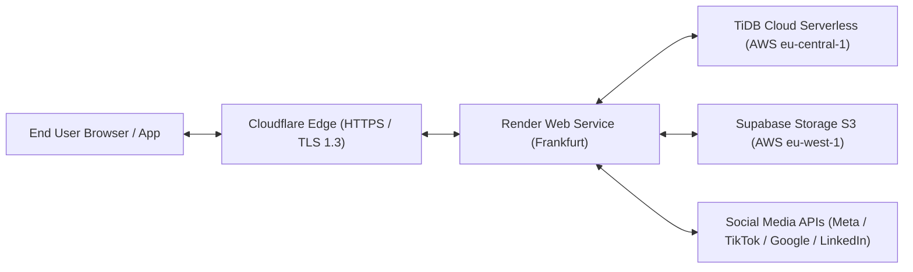

# STAGE 5.6.2 — DATA PRACTICES AUDIT REPORT

**Project:** SocialPilot AI  
**Production Host:** `https://socialpilot-ai-y4lm.onrender.com`  
**Execution Timestamp:** `2026-11-23T14:32:00Z` (`17:32:00` Local)  
**Execution Mode:** STRICT READ-ONLY CODEBASE DATA PRACTICES AUDIT  

---

## 1. PURPOSE & AUDIT SCOPE

This audit inspects the exact data collection, processing, storage, and retention mechanisms implemented in the SocialPilot AI codebase. Its purpose is to provide the empirical technical foundation for the Privacy Policy, Terms of Service, and Data Deletion Instructions, ensuring that all published compliance documentation strictly reflects actual code behavior without unverified claims or omissions.

---

## 2. INVENTORY OF DATA COLLECTED

### 2.1. User Account & Authentication Data
- **Registration Inputs:** `name`, `email` (enforced lowercase, unique index), `password` (hashed via BCRYPT with 12 rounds), acceptance of terms (`terms_accepted_at` timestamp, `terms_version` string).
- **Session Records (`sessions` table):** Session ID, authenticated `user_id`, client IP address (stored in 45-character field for IPv4/IPv6), `user_agent` string, serialized session payload, and timestamp of `last_activity`.
- **API Tokens (`personal_access_tokens` table):** Laravel Sanctum tokens stored as SHA-256 hashes, scoped to `tokenable_id` (`users.id`).

### 2.2. Brand & Strategic Context Data
- **Brand Entity (`brands` table):** `name`, `description`, `category`, `industry`, `niche`, `audience`, `target_age_group`, `audience_interests` (JSON), `region`, `language`, `tone`, `website_url`, `logo_path`, `profile_image_path`.
- **Brand Configuration (`brand_settings` table):** `brand_voice`, `writing_style`, `brand_personality` (JSON), `brand_values` (JSON), `brand_keywords` (JSON), `topics_to_avoid` (JSON), `marketing_objectives` (JSON), `content_preferences` (JSON), `publishing_frequency`, `timezone`, `preferred_publishing_times` (JSON), `hashtag_preferences` (JSON).

### 2.3. Social Media Account & Token Data
- **Account Identity (`social_accounts` table):** `provider` (`facebook`, `instagram`, `tiktok`, `youtube`, `linkedin`), `provider_account_id` (Facebook Page ID, Instagram Business Account ID, TikTok OpenID, YouTube Channel ID, LinkedIn Member/Organization URN), `display_name`, `account_type` (`page`, `professional`, `creator`, `channel`, `personal`, `organization`), `status` (`connected`, `token_expired`, `connection_error`, `not_connected`, `disconnected`), `metadata` (usernames, profile picture/avatar URLs, sync timestamps).
- **OAuth Token Storage (`social_account_tokens` table):**
  - `access_token`: Encrypted at rest using AES-256-CBC with application key (`APP_KEY`). Excluded from API serialization via Eloquent `$hidden`.
  - `refresh_token`: Encrypted at rest using AES-256-CBC. Excluded from API serialization via Eloquent `$hidden`.
  - `expires_at`: Expiration timestamp calculated from provider token exchange response.
  - `scopes`: JSON array of granted OAuth permissions.
- **OAuth State Tracking (`oauth_states` table & Cache):** 64-character random string hashed with SHA-256, mapped to `user_id`, `brand_id`, `provider`, and `mode` with a 10-minute TTL.

### 2.4. Content, Media & Scheduling Data
- **Content Drafts & Revisions (`brand_content_drafts`, `content_revisions`, `content_variations`):** Titles, body text, platform-specific captions, hashtags, content angles, version numbering, generation prompts, and approval states.
- **Media Files (`media_assets` table & Supabase Storage S3):** Uploaded and generated images and videos, file format, MIME type, dimensions (width, height), aspect ratio, file size in bytes, public URLs, and storage paths. Partitioned under `brands/{brand_id}/media/{uuid}.{ext}`.
- **Scheduled Posts & Queue Items (`scheduled_posts`, `publishing_queue_items`):** Scheduled publication timestamp, target social platforms, assigned media assets, custom captions, approval status, and execution state.
- **Publishing Records (`publishing_attempts` table):** Platform name, external post ID returned by provider, external post URL, HTTP response status, error codes, error messages, and raw request/response metadata.

### 2.5. Analytics & Metric Data
- **Analytics Records (`post_analytics`, `analytics_snapshots`, `audience_insights`):** Aggregated metrics retrieved from platform APIs (impressions, reach, likes, comments, shares, video views, engagement rates).

---

## 3. DATA PROCESSING & STORAGE LOCATIONS

| Data Category | Primary Storage Engine | Physical Region | In-Transit Encryption | At-Rest Encryption |
| :--- | :--- | :--- | :--- | :--- |
| **User & Account Data** | TiDB Cloud Serverless (MySQL 8.0) | AWS `eu-central-1` (Frankfurt) | TLS 1.3 / `TLS_AES_128_GCM_SHA256` | Cloud-managed volume encryption |
| **Social OAuth Tokens** | TiDB Cloud Serverless | AWS `eu-central-1` (Frankfurt) | TLS 1.3 | **Application-level AES-256-CBC (`APP_KEY`)** + Cloud volume encryption |
| **Media Files (Images/Videos)**| Supabase Cloud Storage S3 (`media` bucket)| AWS `eu-west-1` (Ireland) | HTTPS (TLS 1.3) | S3 server-side encryption |
| **Web Sessions & Cache** | TiDB Cloud Serverless (`sessions`, `cache` tables) | AWS `eu-central-1` (Frankfurt) | TLS 1.3 | Cloud-managed volume encryption |
| **Application Logs** | Render Ephemeral Logging / Stdout | AWS `eu-central-1` (Frankfurt) | TLS 1.3 | Ephemeral container storage |

---

## 4. THIRD-PARTY DATA PROCESSORS & RECIPIENTS

SocialPilot AI interacts with the following external service providers strictly to deliver core SaaS functionality:

| Third-Party Processor | Role / Function | Data Received from SocialPilot AI | Privacy / Policy Reference |
| :--- | :--- | :--- | :--- |
| **Render Services, Inc.** | Cloud application hosting & runtime | HTTP request traffic, container logs, temporary runtime variables. | `render.com/privacy` |
| **PingCAP (TiDB Cloud)** | Serverless database hosting | All structured database records (users, brands, posts, encrypted tokens). | `pingcap.com/privacy-policy` |
| **Supabase, Inc.** | Cloud object storage (S3) | Media files (images, video files) uploaded by users or generated. | `supabase.com/privacy` |
| **Cloudflare, Inc.** | Reverse proxy, CDN, DDoS mitigation | Incoming IP addresses, HTTP headers, request URLs. | `cloudflare.com/privacypolicy` |
| **Meta Platforms, Inc.** | Facebook & Instagram publishing API | User-approved post captions, uploaded photos/videos, page identifiers. | `facebook.com/privacy/policy` |
| **TikTok Inc. / ByteDance**| TikTok Content Posting API | User-approved video files, captions, privacy settings, creator identifiers. | `tiktok.com/legal/privacy-policy` |
| **Google LLC** | YouTube Data API v3 & OAuth | User-approved video files, video titles, descriptions, tags, channel IDs. | `policies.google.com/privacy` |
| **LinkedIn Corporation** | LinkedIn Share API & OAuth | User-approved post text, images, videos, member URNs, organization URNs. | `linkedin.com/legal/privacy-policy` |

---

## 5. DATA DELETION & DISCONNECTION MECHANISMS

### 5.1. User Account Self-Service Deletion (`DELETE /profile`)
- **Controller:** `ProfileController@destroy`.
- **Validation:** Requires re-entering current user password (`'password' => ['required', 'current_password']`).
- **Execution:** Calls `$user->delete()`, invalidates web session, and regenerates CSRF token.
- **Relational Cascades:** In TiDB, all foreign key relationships from `users` specify `ON DELETE CASCADE`. Deleting a user automatically and permanently deletes:
  - All owned brands (`brands`).
  - All brand settings (`brand_settings`).
  - All media asset records (`media_assets`).
  - All scheduled posts and platform targets (`scheduled_posts`, `scheduled_post_platforms`).
  - All content drafts and revisions (`brand_content_drafts`, `content_revisions`).
  - All connected social accounts and encrypted tokens (`social_accounts`, `social_account_tokens`).
  - All publishing records and notifications (`publishing_attempts`, `publishing_notifications`).

### 5.2. Individual Social Account Disconnection
- **Controller:** `SocialAccountManagementController@destroy`.
- **Authorization:** Verifies `$socialAccount->brand_id === $brand->id && $socialAccount->user_id === $request->user()->id`.
- **Execution via `SocialOAuthService@disconnect`:**
  1. Retrieves the active token.
  2. Invocates the provider's remote token revocation endpoint (e.g. Meta `/me/permissions`, TikTok `/oauth/revoke/`, Google `/revoke`, LinkedIn `/revoke`).
  3. Permanently deletes the `social_account_tokens` record from the database.
  4. Updates the `social_accounts` status to `'disconnected'`.

---

## 6. GAPS IDENTIFIED FOR PUBLIC COMPLIANCE

1. **Missing Public Views:** Dedicated public routes (`/privacy`, `/terms`, `/data-deletion`) do not currently exist as independent Blade views.
2. **Meta Deletion Instructions:** Meta requires a public URL providing exact steps for a user to request data removal when they remove the app from their Facebook settings.
3. **Contact Email:** The configuration setting `CONTACT_EMAIL` is currently unpopulated in production.

*Data practices audit confirmed complete and ready to inform compliance drafting.*
